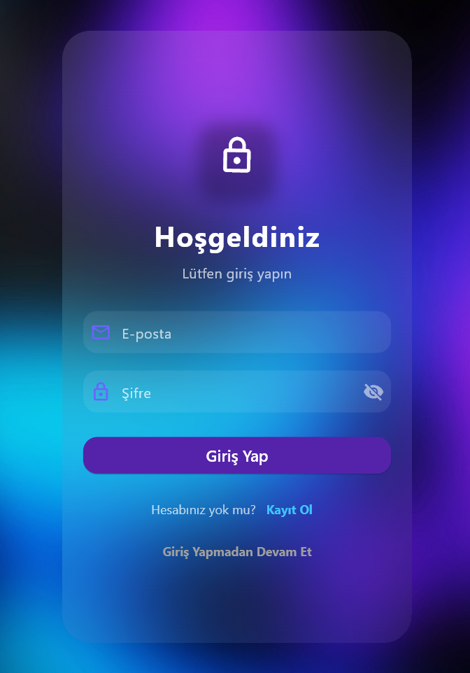
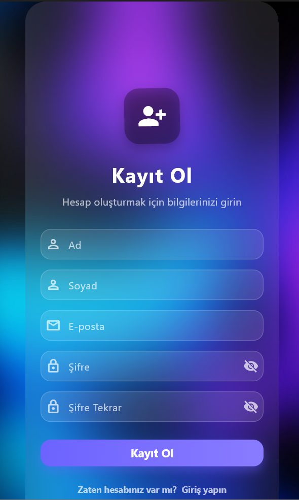
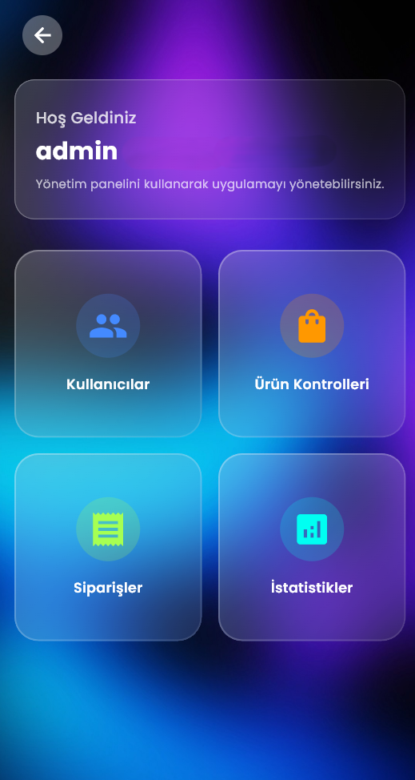
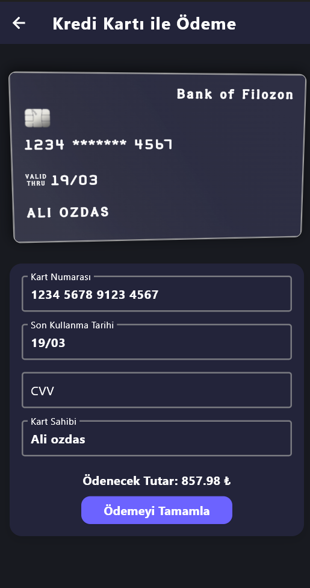

# 🛒 Filozon - E-Commerce & Cloud Storage

<p align="center">
  <a href="README.md">🇬🇧 English</a> • 
  <a href="README.tr.md">🇹🇷 Türkçe</a>
</p>

<p align="center">
  
  
  
  
  
  
</p>

---

> ℹ️ **Note:** This repository was developed as an **internship project** for educational and portfolio demonstration purposes.

**Filozon** is a hybrid cross-platform mobile and web application built with **Flutter** and **Firebase**. It merges a full-featured modern e-commerce shopping experience with a personal cloud file storage and viewer system—packaged in a sleek, frosted **Glassmorphism UI** aesthetic.

---

## 📸 Screenshots

| Sign In (Glassmorphic Card) | Sign Up (Glassmorphic Card) |
| :---: | :---: |
|  |  |

| Admin Dashboard | Payment & Card View |
| :---: | :---: |
|  |  |

---

## ✨ Design Philosophy: Glassmorphism UI

Filozon stands out with its modern **Glassmorphism** visual language crafted across both mobile and web interfaces:

- **Frosted Glass Containers:** Translucent surfaces layered above vibrant gradient backdrops (`GlassmorphicContainer`).
- **Real-Time Blur Effects:** Gaussian blur and dynamic backdrop filtering for optical depth and modern elegance.
- **Subtle Highlights & Borders:** Fine-tuned translucent borders and diffused shadow layers that give cards and modal sheets a floating look.
- **Modern Typography:** Styled with Google Fonts **Kanit** and tailored Material 3 design elements.

---

## 🚀 Key Features

### 🛍️ 1. E-Commerce & Shopping Experience
- **Catalog & Categories:** Dynamic catalog powered by Firebase Cloud Firestore and FakeStore REST API.
- **Detailed Product Showcase:** High-resolution product images, descriptions, pricing, and live inventory state.
- **Cart & Wishlist:** Real-time state management using GetX for instant cart additions, item count changes, and price totals.
- **Address & Order Management:** Multi-address management, complete checkout flow, and past order status tracking.
- **Checkout & Card Interface:** Interactive credit card visualizer, form validation, and checkout simulation.

### ☁️ 2. Filozon Cloud (Personal Cloud Storage)
- **Multi-Format Storage:** Securely upload and organize photos, videos, and PDF documents via Firebase Storage.
- **Integrated Viewers:**
  - 📄 Built-in PDF reader
  - 🖼️ In-app photo gallery viewer
  - 🎥 Video player
- **Hybrid Cross-Platform Uploads:** Optimized file uploads using local paths (`putFile`) on Android and in-memory byte buffers (`putData` / `Uint8List`) on Flutter Web.

### 🛡️ 3. Admin Control Panel
- **Metrics Dashboard:** Real-time metrics tracking total sales, active users, and incoming orders.
- **Inventory & Category CRUD:** Add, update, stock manage, or remove products and categories directly from the admin UI.
- **Order Tracking:** Update lifecycle states of orders (Pending, Shipped, Delivered).
- **User Role Management:** View registered users with role-based access controls.
- **Route Protection:** Route-level security with GetX `AdminMiddleware` preventing unauthorized access.

### 👤 4. Authentication & Security
- **Firebase Authentication:** Email & password registration and login flows.
- **Guest Browsing:** Allows exploratory catalog browsing without requiring an immediate account.
- **User Profile:** Manage shipping addresses, personal details, and avatar preferences.

---

## 🏗️ Architecture & Tech Stack

- **Framework:** Flutter & Dart
- **State Management & Navigation:** [GetX](https://pub.dev/packages/get) (Reactive State, Dependency Injection, Route Middlewares)
- **UI & Styling:** Glassmorphism (`glassmorphism`), Material 3, Google Fonts (`google_fonts`)
- **Backend & Cloud Services (Firebase):**
  - **Firebase Authentication:** User identity & session management
  - **Cloud Firestore:** Real-time NoSQL database
  - **Firebase Storage:** Cloud storage for user media and files
- **Networking:** `http` package for RESTful FakeStore API integration

---

## 📁 Project Structure

```text
lib/
├── app/
│   ├── bindings/             # GetX Dependency Injection definitions
│   ├── controllers/          # Business logic & reactive GetX Controllers
│   ├── middlewares/          # Route & role authentication guards (AdminMiddleware, etc.)
│   ├── models/               # Data models & JSON serialization
│   ├── routes/               # Navigation routes and page bindings (AppPages, AppRoutes)
│   ├── services/             # Firebase, Auth, Firestore, and external API services
│   └── ui/
│       ├── pages/            # Screens (Home, Admin, Cloud, Payment, Login, etc.)
│       └── widgets/          # Reusable UI components & custom widgets
├── firebase_options.dart     # Firebase platform configuration
└── main.dart                 # Application entry point (Init & Theming)
```

---

## 📄 License & Disclaimer

This project was built during an internship period for portfolio, educational, and experimental purposes. All rights reserved.
